<div align="center">




<a href="https://github.com/f25-bsai-0063-pixel">
  
</a>

<br/>


<br/>
<br/>

<a href="https://www.linkedin.com/in/junaid-ul-haq"></a>
<a href="mailto:me.junaidulhaq@gmail.com"></a>
<a href="https://github.com/f25-bsai-0063-pixel"></a>
<a href="https://www.kaggle.com/junaidulhaq0063"></a>

<br/>
<br/>


</div>

---

## About Me

I'm an **Artificial Intelligence undergraduate** at **Riphah International University, Sahiwal**, building a strong base in machine learning, data-driven problem solving, and clean, practical software.

```text
Focus        ->  Machine Learning, Data Analysis, Deep Learning
Foundations  ->  Python, Data Structures & Algorithms, OOP
Mindset      ->  build small, ship often, learn in public
Goal         ->  become an AI engineer who builds solutions that matter
```

**Open to:** collaborations &nbsp;•&nbsp; internships &nbsp;•&nbsp; open-source projects

---

## Journey Timeline

<div align="center">
  
</div>

---

## Tech Stack

**Languages**


**AI / ML & Data**


**Databases**


**Tooling**


---

## AI / ML Focus

| Domain | Level | Details |
| :-- | :--: | :-- |
| Python for AI |  | NumPy, Pandas, Matplotlib workflows |
| Machine Learning |  | Scikit-learn, model evaluation, feature engineering |
| Data Analysis |  | Cleaning, EDA, visualization |
| Data Structures & Algorithms |  | Problem solving and complexity analysis |
| Deep Learning |  | Neural networks with PyTorch and TensorFlow |

---

## Featured Projects

<details open>
<summary><b>First</b> &nbsp;|&nbsp; the start of my open-source journey</summary>

<br/>

| Field | Detail |
| :-- | :-- |
| **Status** | Foundation project |
| **Focus** | Getting comfortable with Git, GitHub, and shipping |
| **Next** | AI and ML projects are on the way |
| **Repository** | [f25-bsai-0063-pixel/First](https://github.com/f25-bsai-0063-pixel/First) |

My first GitHub project. Every large system starts with a first commit.

</details>

<details>
<summary><b>Next up</b> &nbsp;|&nbsp; ML and data projects in the pipeline</summary>

<br/>

| Type | Plan |
| :-- | :-- |
| **ML project** | End-to-end project with a clean dataset, EDA, model comparison, and write-up |
| **Data analysis** | Notebook published on Kaggle |
| **Deep learning** | First neural network built from scratch, then in PyTorch |

</details>

---

## Achievements

<div align="center">

| Recognition | Details |
| :-- | :-- |
| BS Artificial Intelligence | Admitted to Riphah International University, Sahiwal (Fall 2025) |
| Open source | Published first GitHub repository |
| Data community | Active on Kaggle for datasets and notebooks |

</div>

---

## Learning Path


---

## Coding Profiles

<div align="center">

<a href="https://www.kaggle.com/junaidulhaq0063"></a>
<a href="https://github.com/f25-bsai-0063-pixel"></a>

</div>

---

## GitHub Analytics

<div align="center">


</div>

---

## Achievements Unlocked

<div align="center">


</div>

---

## Contribution Activity

<div align="center">


</div>

---

## Contribution Snake

<div align="center">

<picture>
  <source media="(prefers-color-scheme: dark)" srcset="https://raw.githubusercontent.com/f25-bsai-0063-pixel/f25-bsai-0063-pixel/output/github-contribution-grid-snake-dark.svg"/>
  
</picture>

</div>

---

## Current Focus

```yaml
learning:
  - Machine Learning with Scikit-learn
  - Data Structures & Algorithms
building:
  - AI and ML projects, one repo at a time
exploring:
  - Deep Learning with PyTorch and TensorFlow
open_to:
  - Collaborations
  - Internships
  - Open-source projects
```

---

## Connect

<div align="center">

<a href="mailto:me.junaidulhaq@gmail.com"></a>
<a href="https://www.linkedin.com/in/junaid-ul-haq"></a>
<a href="https://github.com/f25-bsai-0063-pixel"></a>
<a href="https://www.kaggle.com/junaidulhaq0063"></a>

<br/>
<br/>

<i>The best way to predict the future is to build it.</i>


</div>
